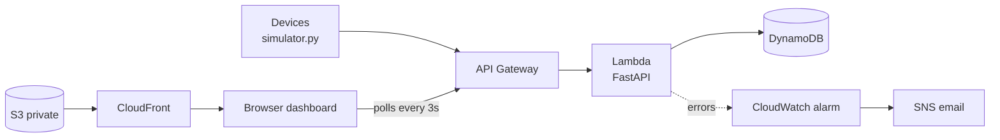

# SensorPulse

A serverless IoT monitoring platform built on AWS. Simulated devices send temperature and humidity readings to a REST API. The backend validates and stores them, flags anomalies, and a live web dashboard shows each device's status and temperature history.


**Live demo**

- Dashboard: https://d2tsrh8xj3szli.cloudfront.net
- API docs (Swagger): https://5x0uj9i6n9.execute-api.eu-west-1.amazonaws.com/docs

## Features

- REST API with input validation (invalid readings are rejected with a 422)
- Automatic anomaly detection: a reading above the temperature threshold (default 28°C) is flagged
- Per-device summaries: average temperature and humidity, max temperature, anomaly count, and an `OK` / `ALERT` status
- Live dashboard that refreshes every 3 seconds, with a chart and a threshold line
- Device simulator that generates realistic readings, including random heat spikes
- Automated tests, including DynamoDB tests that run against a mocked AWS (no real account needed)
- Email alert when the Lambda function fails

## Architecture



| Component | Role |
|---|---|
| API Gateway (HTTP API) | Public HTTPS entry point that triggers the Lambda function |
| Lambda (Python 3.12) | Runs the FastAPI app through the Mangum adapter |
| DynamoDB | Stores readings. Partition key `device_id`, sort key `timestamp`, on-demand billing |
| S3 + CloudFront | Hosts the dashboard. The bucket is private and only CloudFront can read it (Origin Access Control) |
| CloudWatch + SNS | Alarm on Lambda errors, with an email notification |
| IAM | Lambda role limited to `PutItem`, `Query` and `Scan` on a single table (least privilege) |

## API

| Method | Endpoint | Description |
|---|---|---|
| `POST` | `/readings` | Submit a reading |
| `GET` | `/devices` | List known devices |
| `GET` | `/devices/{id}/readings?limit=50` | Latest readings for a device |
| `GET` | `/devices/{id}/summary` | Averages, max temperature, anomaly count, status |
| `GET` | `/health` | Health check |

Example:

```bash
curl -X POST https://5x0uj9i6n9.execute-api.eu-west-1.amazonaws.com/readings \
  -H "Content-Type: application/json" \
  -d '{"device_id": "sensor-1", "temperature": 35, "humidity": 50}'
```

Response:

```json
{
  "device_id": "sensor-1",
  "temperature": 35.0,
  "humidity": 50.0,
  "timestamp": "2026-11-12T22:38:23.807336+00:00",
  "anomaly": true
}
```

## Tech stack

Python, FastAPI, Pydantic, boto3, Mangum, pytest, moto, AWS Lambda, API Gateway, DynamoDB, S3, CloudFront, CloudWatch, SNS, IAM, GitHub Actions, HTML, JavaScript, Chart.js.

## Run it locally

```bash
python3 -m venv .venv
source .venv/bin/activate
pip install -r requirements.txt
uvicorn app.main:app --reload
```

- Open http://127.0.0.1:8000/docs to try the API.
- In a second terminal, run `python simulator.py` to send fake readings.
- Open `dashboard/index.html` in a browser to see the dashboard.
- Run the tests with `pytest`.

Locally the API keeps data in memory. When the `TABLE_NAME` environment variable is set (as it is on Lambda), it uses DynamoDB instead.

## Project structure

```
app/
  main.py            FastAPI app, validation, anomaly logic, Lambda handler
  dynamo_store.py    DynamoDB storage layer
dashboard/
  index.html         Single-page dashboard (HTML, JS, Chart.js)
tests/
  test_api.py        API tests
  test_dynamo_store.py  Storage tests using moto
simulator.py         Fake IoT devices
.github/workflows/   CI workflow that runs pytest on every push
```

## Design decisions

- **Swappable storage.** The API talks to a store with `add`, `get` and `devices` methods. Locally and in tests that is an in-memory store, and in AWS it is DynamoDB. The endpoints don't change.
- **DynamoDB key design.** Partitioning by `device_id` and sorting by `timestamp` means "latest readings for one device" is a single efficient query, with no table scan.
- **Serverless.** No servers to patch or scale, and the cost is close to zero at low traffic.
- **Private bucket behind CloudFront.** The dashboard is served over HTTPS and the bucket itself is never public.
- **Least-privilege IAM.** The Lambda role can only do three actions on one table.
- **Testing AWS code without AWS.** moto mocks DynamoDB, so the storage tests are fast, free and safe.
- **XSS protection.** The dashboard escapes device names before rendering them.

## Deployment overview

Everything was created from the AWS CLI:

1. DynamoDB table `SensorReadings` (on-demand)
2. IAM role for Lambda with logging permissions and a table-scoped DynamoDB policy
3. Lambda package built for Linux (`pip install --platform manylinux2014_x86_64 --only-binary=:all:`), then `aws lambda create-function` with handler `app.main.handler`
4. HTTP API in API Gateway pointing at the function, plus an invoke permission
5. Private S3 bucket and a CloudFront distribution with Origin Access Control
6. CloudWatch alarm on Lambda errors, notifying an SNS topic by email

## Known limitations and next steps

- Add authentication (an API key or JWT per device). The API is currently open, protected only by throttling.
- Restrict CORS to the dashboard domain instead of allowing all origins.
- Define the infrastructure as code (Terraform or CloudFormation) instead of CLI commands.
- Put SQS in front of Lambda to absorb traffic spikes, and keep a separate devices table instead of scanning.
- Replace the fixed threshold with a model that learns each device's normal range.
- Replace polling with WebSockets or AWS IoT Core for true real-time updates.

## What I learned

- Packaging Python dependencies for Lambda, and why they must be built for Linux
- How API Gateway, Lambda and IAM fit together, and why least privilege matters
- DynamoDB key design, and why floats must be stored as Decimals
- How to test cloud code with mocks
- Signing in to AWS with SSO and temporary credentials
