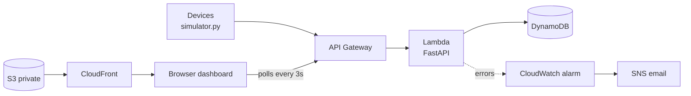

# IoT Sensor Monitor

Simulated IoT devices send temperature and humidity readings to a FastAPI
backend, which stores them, calculates summaries and flags anomalies.

## Run locally
    python -m venv .venv && source .venv/bin/activate   # Windows: .venv\Scripts\activate
    pip install -r requirements.txt
    uvicorn app.main:app --reload
    # open http://127.0.0.1:8000/docs
    python simulator.py        # in a second terminal
    pytest

## Endpoints
- POST /readings
- GET  /devices/{id}/readings
- GET  /devices/{id}/summary
- GET  /health

## Roadmap
- [x] Step 1: API + tests + simulator
- [ ] Step 2: Dashboard
- [ ] Step 3: DynamoDB storage
- [ ] Step 4: Deploy on AWS (Lambda, API Gateway, S3, CloudFront)
- [ ] Step 5: CI with GitHub Actions
## Architecture

## Live demo
- Dashboard: https://d2tsrh8xj3szli.cloudfront.net
- API docs: https://5x0uj9i6n9.execute-api.eu-west-1.amazonaws.com/docs
